

  

# Sufra : case study

Arabic-first food and nutrition companion for Android, built with Flutter and Firebase. The source code is private (client work). This page covers the product and the engineering. Every screen on this page is real footage from the app itself - test-suite renders and recorded runs on the real build.

## Product thinking

- **Arabic-first, not translated.** The interface is designed right-to-left from the first pixel: Egyptian food names, Arabic-Indic numerals where they belong, hand-picked Arabic display typography, full English as a second citizen.
- **Design before code.** The whole app was designed first as a complete HTML design system (colors, glass components, motion, every screen), then implemented in Flutter against that reference, so the UI reads as one product instead of assembled widgets.
- **Free tier as a hard constraint.** Every layer runs on free tiers: Firebase Spark, Cloudflare Workers free tier, Workers AI free allocations, Open Food Facts and USDA databases. Quotas are enforced as ceilings that stop requests instead of ever billing. Zero-cost infrastructure was a design requirement, not a lucky accident.
- **Honest UX.** Real sourced nutrition or a clear empty state, never an invented number. Consent before a photo leaves the device. Errors mapped to words people actually understand.

## What it does

- Meal logging by search, barcode scan, voice and photo, with calorie and macro values
- Water and weight tracking, daily and weekly stats, PDF report (Arabic and English)
- Meal planning, shopping list, reminders, Ramadan mode
- AI coach with goals and daily steps, chatting in Egyptian Arabic
- Light and dark themes, glass-style UI, full RTL support

## The app, for real

<table>
  <tr>
    <td> Log it your way: voice, barcode, photo, favorites or search</td>
    <td> The daily diary at a glance</td>
    <td> Streaks and weekly statistics</td>
  </tr>
  <tr>
    <td> Ramadan mode, suhoor to iftar</td>
    <td> Real dishes, real numbers</td>
    <td> Barcode to Nutri-Score, ingredients and allergens</td>
  </tr>
  <tr>
    <td> Snap the plate, get real nutrition</td>
    <td> The coach, chatting in Egyptian Arabic</td>
    <td> The week, planned</td>
  </tr>
</table>

## Architecture

  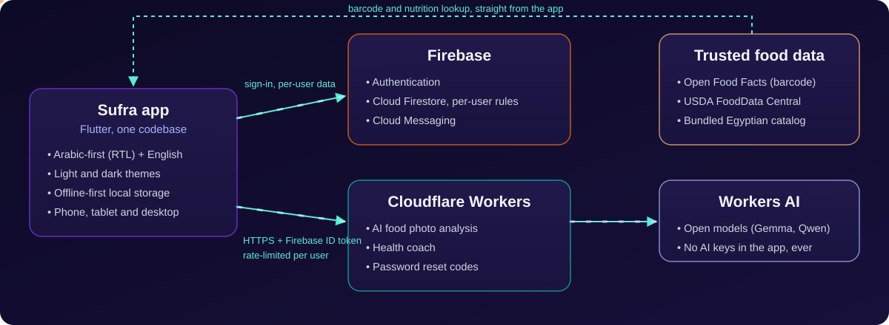

- Flutter app with a feature-first structure (`app / core / data / features / services / l10n`)
- State management with Cubit (BLoC pattern); repository layer over REST and the Firebase SDKs
- Firebase Auth (email/password and Google), Cloud Firestore with per-user security rules, Firebase Cloud Messaging
- Serverless Cloudflare Workers as the AI gateway, one for food-photo analysis, one for the coach, one for password-reset codes. Keys stay server-side; the app authenticates with its Firebase ID token
- Offline-first: local caches and a queued ledger, so logging works on a bad network and syncs afterwards
- Auth-aware routing: a signed-out session lands on login; sign-out unlinks the push token and clears the device Google account

## AI

- Food-photo analysis: the photo is rebuilt on the phone (orientation fixed, EXIF and location stripped, resized and compressed) before it goes anywhere. A vision model on Workers AI names the dishes and estimates portions, and every item is matched to a sourced food record before saving
- AI coach: open models (Gemma, Qwen) behind a worker, answering in Egyptian Arabic with access to the user's app data (meals, water, weight, goals) for personal guidance
- Model evaluation: benchmarked several open models (Llama, Mistral, Gemma) for Arabic dialect quality and food accuracy before choosing; turned down a free hosted tier whose terms allowed content review, on privacy grounds
- Cost ceiling by design: free-tier quotas that stop requests instead of billing

## Security and privacy

- HTTPS-only networking; cleartext traffic and cloud auto-backup disabled on Android
- No passwords, tokens or credentials stored by the app; nothing sensitive in logs
- Worker endpoints verify the Firebase ID token and rate-limit per user
- Timeouts on all auth calls, double-tap and duplicate-request guards, mapped rate-limit and network error messages
- Per-user Firestore security rules; per-photo consent before any image leaves the device

## Beyond Flutter

The app is the visible half. The engineering range behind it:

- **Backend design:** Firebase Auth, Firestore data modeling with per-user rules, Cloud Messaging
- **Edge compute:** three serverless Cloudflare Workers with token verification, per-user rate limiting and strict secrets handling
- **Applied AI:** vision and chat model selection, Arabic-dialect evaluation, prompt and pipeline design, silent model fallback for uptime
- **Offline-first systems:** local caches, a queued sync ledger, conflict-safe logging on unreliable networks
- **Design engineering:** a hand-built glass design system, Arabic typography (seven bundled families with fallback chains), RTL layout discipline, hand-written animations with no animation packages
- **Quality engineering:** unit, widget and responsive layout tests; golden renders that load the app's real fonts so Arabic typography is verified pixel by pixel in CI
- **Native layer:** Kotlin Android shell, signing and release pipeline, Play-ready configuration

## Quality

- Unit, widget and responsive layout tests; golden renders verified in Arabic dark and English light
- OTP-style verification-code input with paste support and Arabic-Indic digit handling
- Full RTL Arabic/English localization; light and dark glass design system

## Contact

Mostafa Ghonime · [GitHub](https://github.com/mostafa-ghonime) · [LinkedIn](https://www.linkedin.com/in/mostafaghonime10) · mostafaghonime1@gmail.com
